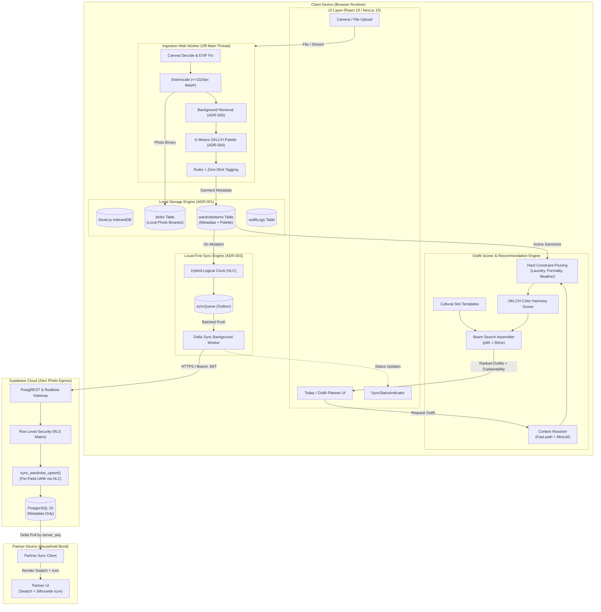

# ourCloset — System Architecture

This document provides a comprehensive technical overview of `ourCloset`'s client-first, Zero-Key architecture. Designed for modern mobile and desktop browsers, `ourCloset` delivers AI-powered wardrobe and couple/family coordination with zero cloud photo egress, zero paid API dependencies, and full offline resilience.

---

## 1. Architectural Tenets

Every architectural decision in `ourCloset` is governed by three non-negotiable tenets:

1. **Tenet 1: 100% Client-Side Privacy (Zero-Key)**
   - No garment photos ever leave the user's device (ADR-002).
   - All computer vision, segmentation, and vector embeddings execute locally in-browser using WebAssembly (WASM) and Web Workers.
   - Cloud synchronization operates strictly on anonymized metadata.
   - The platform requires zero external paid API keys (no OpenAI, no Anthropic, no paid cloud vision APIs).

2. **Tenet 2: Deep Cultural Fluency**
   - Wardrobe logic natively models non-Western attire through declarative cultural slot templates (e.g. Shalwar Kameez, Kurta Pajama, Saree Blouse, Abaya Hijab) rather than forced Western approximations.
   - Evaluated across three distinct taxonomies: Western Contemporary, South Asian / Indian Traditional, and Islamic-Modest.
   - Rigorous evaluation benchmarks enforce $\ge 80\%$ precision@3 and strict modesty floors.

3. **Tenet 3: Atelier Craftsmanship**
   - High-performance, tactile interaction inspired by fine tailoring ("Raw Silk & Charcoal Thread" design language).
   - Strict performance budgets: First Load JS $< 300\text{kB}$, Outfit Generation p95 $< 50\text{ms}$, Interaction to Next Paint (INP) $< 200\text{ms}$.
   - Complete accessibility (WCAG 2.2 AA) and `prefers-reduced-motion` compliance.

---

## 2. End-to-End System Data Flow

The following sequence details how garments enter the system, how outfits are scored and assembled, and how household data synchronizes without leaking sensitive photos.



---

## 3. Core Component Architecture

### 3.1 Ingestion Pipeline (`src/features/ingestion`)
Heavy image processing and segmentation run inside a dedicated Web Worker (`ingestionWorker.ts`), communicating via structured clone message transfers to keep the main thread fluid (INP $< 200\text{ms}$).

1. **Preprocessor**: Decodes image buffers, fixes EXIF orientation, and downscales the bitmap to $\le 1024\text{px}$ preserving aspect ratio.
2. **Segmenter (ADR-005, ADR-006)**:
   - Tier 1: WebGPU / WASM quantized segmentation.
   - Tier 2: Canvas GrabCut fallback for devices below memory thresholds ($< 4\text{GB}$ RAM).
   - Auto-crops to foreground bounding box with an atelier soft margin.
3. **OKLCH Palette Extractor (ADR-004)**: Runs k-means clustering in OKLCH color space exclusively on foreground pixels, isolating primary and secondary lightness, chroma, and hue.
4. **Tag Suggester**: Classifies garment category, formality level, and cultural silhouette using heuristics combined with zero-shot label similarity.

---

### 3.2 Local-First Storage Layer (`src/data`)
Storage is managed by `Dexie.js` wrapping the browser's IndexedDB, enforcing strong typing and versioned schema migrations (ADR-001).

```typescript
// Schema Definition in src/data/db.ts
this.version(2).stores({
  wardrobeItems: 'id, user_id, category, cultural_style, formality_level, laundry_status, privacy_tier, created_at, updated_at, deleted_at, [user_id+laundry_status], [cultural_style+category]',
  outfitLogs: 'id, household_id, worn_by, worn_at, created_at, [worn_by+worn_at]',
  members: 'id, household_id, name, role, hierarchyRole, privacyTier, joinedAt',
  household: 'id, household_type, sync_status, created_at',
  blobs: 'id, mimeType, size, createdAt',
  syncQueue: 'id, table, entityId, action, status, hlc, idempotencyKey, createdAt, [table+entityId], [status+createdAt]',
});
```

- **Blobs Store**: Houses raw image data URLs (`data:image/webp;base64,...`). Isolated completely from sync queries.
- **Repository Pattern**: React components never call Dexie directly. All interactions flow through typed repositories (`wardrobeRepository.ts`, `outfitRepository.ts`), which automatically enqueue outbox mutations upon write.

---

### 3.3 Outfit Coordination Engine (`src/engine`)
The recommendation engine is a pure, side-effect-free TypeScript package. It contains no React hooks, no DOM dependencies, and no non-deterministic system clock reads.

```
INPUT: (Garment Catalog, Context Criteria, Weather, Household Constraints)
                            │
                            ▼
              [ 1. Context Resolution ]
        Fast-path keyword scoring + MiniLM semantic fallback
                            │
                            ▼
              [ 2. Hard Constraint Pruning ]
        • Filter dirty laundry (laundry_status !== 'CLEAN')
        • Enforce formality window: contextFormality ± 1
        • Enforce weather temperature & precipitation boundaries
        • Filter private items from partner view
                            │
                            ▼
              [ 3. OKLCH Color Harmony Scoring ]
        Perceptual Euclidean distance ΔE_OKLCH across 5 geometries:
        Monochrome | Analogous | Complementary | Split | Neutral-Anchored
                            │
                            ▼
              [ 4. Cultural Template Slot Matching ]
        Select slot archetype (e.g. Kurta + Pajama + Dupatta + Mojari)
                            │
                            ▼
              [ 5. Beam Search Combinatorial Assembler ]
        Prunes search space (Beam width k=5). Budget: p95 < 50ms.
                            │
                            ▼
OUTPUT: Ranked Outfit Candidates with Deterministic Match Reasons
```

---

### 3.4 Hybrid Logical Clock (HLC) & Sync Protocol (`src/data/sync`)
Distributed multi-device coordination is achieved without centralized clock synchronization (ADR-003):

- **HLC Structure**: Each mutation carries an ISO timestamp string combining physical time, a logical tick counter, and a stable client node identifier:
  $$\text{HLC} = (l, c, d)$$
  Where $l$ is physical millis, $c$ is logical counter, and $d$ is client node UUID.
- **Per-Field Last-Write-Wins (LWW)**: Postgres maintains a JSONB map of per-field HLC values (`field_hlc`). If Device A edits `formality_level` while offline and Device B edits `laundry_status` concurrently, both updates merge deterministically without overwriting each other.
- **Tombstones & Resurrection**: Deletions write `deleted_at = now()` and a `deleted_at` HLC. If an edit occurs with an HLC newer than the delete tombstone, the item is resurrected ("edit-after-delete un-delete").
- **Cursor Delta Pull**: Sync pull uses monotonic server sequences (`server_seq`) with an overlap window (`pullOverlap = 25`) to guarantee no writes are skipped during concurrent commit re-ordering.

---

### 3.5 Supabase Security & Row Level Security (RLS)
The database enforces strict privacy boundaries directly inside Postgres:

| Table | Policy / Rule | Purpose |
|---|---|---|
| `profiles` | Users can only read/write their own profile (`auth.uid() = id`). | Personal identity protection. |
| `households` | Only owners can update/delete; members can view their active household. | Household governance. |
| `household_members` | Direct insert/update disabled. Joins permitted only via `join_household()` RPC using single-use 6-character invite codes. | Anti-tampering & invite gating. |
| `wardrobe_items` | Owners have full CRUD. Household partners can `SELECT` metadata if `privacy_tier = 'PUBLIC'`. Outsiders see 0 rows. | Zero cross-household or private data leakage. |
| `outfit_history` | Members of the same household can read outfit logs; only the wearer can update/delete their wear log. | Collaborative planning with audit integrity. |

---

## 4. Architecture Decision Records (ADR) Index

| ADR | Title | Decision | Impact |
|---|---|---|---|
| [ADR-001](../md_files/adr/ADR-001-local-storage-dexie.md) | **IndexedDB with Dexie.js** | Migrate from unstructured `idb-keyval` to Dexie schema with compound indexes. | Fast indexed lookups by status/owner; atomic transactions. |
| [ADR-002](../md_files/adr/ADR-002-garment-photos-privacy.md) | **Garment Photos Privacy Boundary** | Zero photo egress to Supabase. Metadata only syncs; partners see swatches and silhouette icons. | Complete personal privacy; eliminates cloud storage cost. |
| [ADR-003](../md_files/adr/ADR-003-hybrid-logical-clock-conflict-resolution.md) | **HLC Conflict Resolution** | Per-field Last-Write-Wins with Hybrid Logical Clocks and soft-delete tombstones. | Safe offline multi-device sync without clock drift hazards. |
| [ADR-004](../md_files/adr/ADR-004-embedding-dimensions-and-oklch-color.md) | **OKLCH Color Space & 384-d Embeddings** | Drop server pgvector. Compute color harmony in OKLCH; client-side MiniLM 384-d embeddings. | Deterministic, explainable color harmony; zero cloud vector cost. |
| [ADR-005](../md_files/adr/ADR-005-background-removal-model.md) | **Background Removal Model Selection** | Quantized RMBG / MODNet in Web Worker with canvas GrabCut fallback. | High quality client segmentation with permissive licensing. |
| [ADR-006](../md_files/adr/ADR-006-web-worker-and-inference-tiers.md) | **Web Worker & Inference Tiers** | Execute vision and ML off main thread with WebGPU $\to$ WASM $\to$ Canvas fallbacks. | Maintains 60fps UI and INP $< 200\text{ms}$ on low-end phones. |
| [ADR-007](../md_files/adr/ADR-007-demo-isolation-and-frozen-fixtures.md) | **Demo Route Isolation** | Isolate `/demo` completely from production storage using frozen immutable fixtures. | Safe public testing without polluting real user databases. |

---

## 5. Security & Threat Mitigation Summary

A full threat model is maintained in `md_files/threat_model.md`. Key mitigations:
- **Egress Firewall via Content Security Policy (CSP)**: `connect-src` restricted to app origin, Open-Meteo, and designated Supabase project. Any rogue script attempting photo exfiltration is blocked by browser network enforcement.
- **Client Cryptography**: In-flight synchronization uses TLS 1.3 with Supabase RLS authentication tokens.
- **Data Erasure**: Deleting an account (`deleteUserAccount`) executes a server cascade RPC followed by a local IndexedDB wipe, ensuring zero residual traces.

