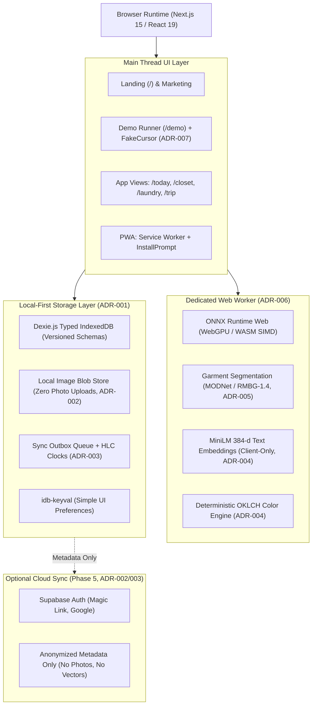

# ourCloset — Pre-Claude Phase Context & Comprehensive Project Blueprint

> **Document Purpose**: Serves as the authoritative, single-source-of-truth project context document for `ourCloset` at the conclusion of the initial architecture & prototype phase, prior to entering the Claude-assisted deep implementation, refinement, and productionization phase.
>
> **Project Repository**: `ourCloset` (`https://github.com/v500nm/ourCloset`)  
> **Author & Creator**: Adnan Mangaonkar (`https://adnan-mangaonkar.com`)  
> **Production Domain**: `https://ourcloset.adnan-mangaonkar.com`  
> **Current Status**: **Functional MVP / Building / Hand-off to Claude Phase**  
> **Last Updated**: November 2026  

---

## Table of Contents
1. [Executive Summary & Core Motive](#1-executive-summary--core-motive)
2. [Problem Statement & The "Why"](#2-problem-statement--the-why)
3. [The Three Non-Negotiable Core Tenets](#3-the-three-non-negotiable-core-tenets)
4. [Ecosystem & Creator Context](#4-ecosystem--creator-context)
5. [Current Project Phase & High-Level Status](#5-current-project-phase--high-level-status)
6. [Complete Feature & Route Inventory](#6-complete-feature--route-inventory)
7. [System Architecture & Technical Stack](#7-system-architecture--technical-stack)
8. [Zero-Key Client-Side AI & Local-First Engine](#8-zero-key-client-side-ai--local-first-engine)
9. [Interactive Demo Choreography Engine (`/demo`)](#9-interactive-demo-choreography-engine-demo)
10. [Progressive Web App (PWA) Architecture](#10-progressive-web-app-pwa-architecture)
11. [Haute Couture Atelier UI/UX Design System](#11-haute-couture-atelier-uiux-design-system)
12. [Codebase Directory Map](#12-codebase-directory-map)
13. [Pre-Claude Gap Analysis & Technical Debt](#13-pre-claude-gap-analysis--technical-debt)
14. [Actionable Roadmap & Guidelines for the Claude Phase](#14-actionable-roadmap--guidelines-for-the-claude-phase)

---

## 1. Executive Summary & Core Motive

`ourCloset` is a modern, zero-key, client-side AI wardrobe coordination engine engineered specifically for couples, siblings, families, and shared households. It solves the daily friction of coordinating clothing across multi-cultural contexts—seamlessly bridging **Western**, **Indian Traditional**, and **Islamic-Modest** dress codes.

Unlike conventional wardrobe applications that treat fashion as an isolated, single-person experience with a Western-only catalog, `ourCloset` introduces the **Shared Closet Loop**:
- A multi-member roster that lets partners harmonize their daily looks ("OOTD RSVP").
- Cultural-aware harmony rules (e.g., matching a linen Abaya with a tailored navy trench, or pairing a gold Zari Sherwani with a companion's silk dupatta).
- Strict **100% Client-Side Privacy**: All computer vision (background removal, feature extraction) and natural language context parsing run inside the user's browser via WebAssembly (WASM), ONNX, and local heuristics. **No personal photos ever leave the device** (formally codified in [ADR-002](./adr/ADR-002-garment-photos-privacy.md)).
- **Zero Paid AI API Costs**: Does not depend on OpenAI, Anthropic, Google, or any paid cloud inference endpoints for its core loops.

> **Implementation Baseline (November 2026 Audit)**:  
> The front-end view layer, marketing pages, design tokens, and interactive demo choreography (`/demo`) are 100% complete and production-ready. However, as audited in `claudePhasePlan.md`, the domain and storage layers are currently in-memory mock prototypes (`WardrobeProvider` uses `useState(MOCK_WARDROBE)`, ingestion returns `null` stubs, and auth uses `localStorage`). The real local-first Dexie database, pure TypeScript outfit engine, client-side vision pipeline in Web Workers, and two-way Supabase sync are staged across Phases 0–7 as governed by Architecture Decision Records [ADR-001 through ADR-007](./adr/README.md).

---

## 2. Problem Statement & The "Why"

### 2.1 The Daily Coordination Dilemma
Couples, housemates, and families navigating modern life frequently attend diverse events—corporate dinners, weekend brunches, religious gatherings (e.g., Eid prayers, Friday Jummah), family weddings (e.g., Sangeet, Mehendi, Nikah), and cross-cultural galas.
1. **Decision Fatigue**: An estimated 15–25 minutes are wasted daily deliberating "What are you wearing?" and manually holding clothes together in front of bedroom mirrors or exchanging phone photos.
2. **Accidental Clashing or Incompatible Formality**: One partner wears a relaxed casual linen shirt while the other wears high-formality silks, or contrasting color palettes violently clash under event lighting.
3. **Single-User Bias in Existing Tech**: Current closet management apps (Stylebook, Whering, Cladwell) assume an isolated single user with Western silhouettes. None have first-class concepts of **household pairing**, **asymmetric twinning**, or **cultural dress code taxonomy**.
4. **Privacy Anxiety**: Users are rightfully hesitant to upload photos of their personal bedrooms, private garments, or traditional modesty wear to cloud servers where third-party AI models train on user media.

### 2.2 The Solution
`ourCloset` delivers a collaborative wardrobe dashboard that treats the household closet as a shared atelier workshop. It provides structured presets and freeform natural-language context resolution to output complementary outfit combinations across three distinct coordination tiers:
- **Tier 1: Subtle Harmony** (accent and hardware matching, e.g., hijab undertone matching lapel pin or watch).
- **Tier 2: Balanced Co-Op** (formality alignment ±1 level, balanced silhouette weights).
- **Tier 3: Direct Twinning** (direct cultural style and deliberate colorway synchronization for festive occasions).

---

## 3. The Three Non-Negotiable Core Tenets

Every architectural decision and line of code in `ourCloset` must strictly uphold three tenets:

| # | Tenet | Practical Enforcement |
|---|---|---|
| **1** | **100% Client-Side Privacy (Zero-Key)** | AI inference (segmentation, background removal, feature extraction, text parsing) must run purely in-browser using WebAssembly/ONNX (`@xenova/transformers`) and deterministic heuristics. Zero cloud photo uploads. |
| **2** | **Deep Cultural Fluency** | Western, Indian Traditional, and Islamic-Modest taxonomies are first-class citizens. Color harmony models, formality scores (1–5), and silhouette compatibility understand Kurtas, Sherwanis, Sarees, Abayas, Hijabs, and Western tailoring natively. |
| **3** | **Atelier Craftsmanship (Anti-Slop Design)** | The UI rejects generic SaaS templates (purple gradients, standard bootstrap cards). It embodies a tactile "Raw Silk & Charcoal Thread" tailoring workshop with hand-stitched dashed borders, bespoke typography (Domine + Inter + JetBrains Mono), and physical spring micro-interactions. |

---

## 4. Ecosystem & Creator Context

`ourCloset` is created by **Adnan Mangaonkar** as a flagship product in his interconnected suite of high-performance web applications:

```
┌────────────────────────────────────────────────────────────────────────┐
│                   Adnan Mangaonkar Ecosystem                           │
├────────────┬───────────────────────────────────────────┬───────────────┤
│ Project    │ Description                               │ Status        │
├────────────┼───────────────────────────────────────────┼───────────────┤
│ SortStory  │ Gamified DSA challenges & visualizations  │ Released      │
│ Adnan OS   │ Web desktop & browser-based terminal IDE  │ Launched      │
│ ourCloset  │ Zero-Key AI Wardrobe Coordination Engine  │ Building/MVP  │
│ FinXpense  │ Brutalist wealth management terminal      │ Building      │
│ Consulting │ Software Architecture & AI Engineering    │ Active        │
└────────────┴───────────────────────────────────────────┴───────────────┘
```

The app features an integrated ecosystem banner, portfolio breadcrumbs, verified SEO metadata, and unified brand styling linking back to `adnan-mangaonkar.com`.

---

## 5. Current Project Phase & High-Level Status

### Current Phase: **Phase 0 — Engineering Baseline & Architecture Decision Alignment**
> *Supersedes preliminary pre-audit phase numbering. Project execution follows the 8-phase roadmap in `md_files/claudePhasePlan.md` and Architecture Decision Records [ADR-001 through ADR-007](./adr/README.md).*

```
┌──────────────────────────────────────┐     ┌──────────────────────────────────────┐
│       PHASE 0 (IN PROGRESS)          │     │       PHASE 1 (NEXT)                 │
│  - Tooling: Vitest, Playwright, CI   │     │  - Typed Dexie.js repository layer   │
│  - Network-assertion privacy test    │ ──> │  - Versioned IndexedDB migrations    │
│  - ADR-001 through ADR-007 codified  │     │  - Real persistence surviving reload │
│  - Honest documentation alignment    │     │  - Clean first-run empty closet      │
└──────────────────────────────────────┘     └──────────────────────────────────────┘
                  │
                  ▼
┌──────────────────────────────────────┐     ┌──────────────────────────────────────┐
│       PHASES 2–4 (ENGINE & PIPELINE) │     │       PHASES 5–7 (SYNC & PRODUCTION) │
│  - P2: Pure TS outfit engine (OKLCH) │     │  - P5: Real Supabase Auth & HLC sync │
│  - P3: Web Worker vision ingestion   │ ──> │  - P6: WCAG 2.2 AA, PWA, CSP nonces  │
│  - P4: Weather API & no-repeat guard │     │  - P7: Beta testing & final launch   │
└──────────────────────────────────────┘     └──────────────────────────────────────┘
```

### Current Status Audit (What Is Shipped vs. What Is Greenfield):
1. **Next.js 15 (App Router) + React 19 Foundation**: Fully configured with TypeScript 5.7, TailwindCSS v3.4, PostCSS, and strict security headers (`next.config.mjs`).
2. **Landing Page (`/`)**: **100% Complete & Production-Ready**. Rich scrollytelling experience powered by Framer Motion (`useScroll`, `useTransform`) and Lenis smooth scrolling. Includes Hero, 3D Bento Grid, Asymmetric Timeline Showcase, Pricing card fan-out, and CTA.
3. **Automated Interactive Demo (`/demo`)**: **100% Complete & Production-Ready**. State-machine-driven live walkthrough with animated SVG spring cursor (`FakeCursor`), virtual smooth-scrolling (`transform: translateY`), real DOM target tracking, simulated character typing, privacy alias masking, and 30-day cookie persistence. Per [ADR-007](./adr/ADR-007-demo-isolation-and-frozen-fixtures.md), target element IDs are locked (`demo-couple-btn`, `demo-wedding-btn`, `demo-input-field`, `demo-generate-btn`) and isolated from live user storage.
4. **Application View Layer (`/today`, `/closet`, `/laundry`, `/history`, `/trip`, `/setup`)**: **Visual Shell 100% Complete**. Bespoke atelier design system, responsive drawer, desktop header, and bottom navigation tab bar.
5. **Wardrobe Persistence (Reality: In-Memory Mock)**: `WardrobeProvider` currently runs on `useState(MOCK_WARDROBE)`. No wardrobe mutations persist across browser refresh; Sunday laundry reset currently executes inside a component `useEffect`. Real typed persistence with compound indexes (`ownerId`, `laundry_status`, `category`) and versioned migrations will be introduced in Phase 1 using Dexie.js ([ADR-001](./adr/ADR-001-local-storage-dexie.md)).
6. **Authentication (Reality: LocalStorage Mock)**: `AuthProvider` currently uses a hardcoded `mock_users_db` array stored in `localStorage` for UI testing. Real Supabase Auth (email magic links, Google OAuth, and RLS) is scheduled for Phase 5.
7. **Ingestion Pipeline (Reality: Greenfield Stubs)**: `IngestionModal.tsx` provides the upload and progress UI, but all four functions in `src/features/ingestion/services/ingestionService.ts` return `null` stubs, and `@imgly/background-removal` is uninstalled. Real client-side segmentation running in a dedicated Web Worker is scheduled for Phase 3 ([ADR-005](./adr/ADR-005-background-removal-model.md), [ADR-006](./adr/ADR-006-web-worker-and-inference-tiers.md)).
8. **Outfit Coordination & Twinning (Reality: Static Fixtures)**: `twinningService.ts` currently returns static mock items. A pure TypeScript combinatorial engine using deterministic OKLCH color harmony rules and formality constraints is scheduled for Phase 2 ([ADR-004](./adr/ADR-004-embedding-dimensions-and-oklch-color.md)).
9. **Progressive Web App (Reality: Basic Shell)**: Validated Web App Manifest, icon suite, and smart install prompt with settled pill badge. The current `sw.js` is a basic hand-written script with a single `ourcloset-v1` cache; offline navigation currently falls back to `/` for all routes. A comprehensive service worker precaching application shells per route is scheduled for Phase 6.

---

## 6. Complete Feature & Route Inventory

| Route | Name / Module | Core Functionality | Current Implementation State | Target Phase |
|---|---|---|---|---|
| `/` | **Landing Page** | Scrollytelling presentation, interactive bento showcase, timeline demo, pricing plans, portfolio ecosystem link. | **100% Complete** (Production Ready) | Shipped |
| `/demo` | **Automated Demo** | Zero-login automated tour, SVG spring cursor, step waypoints, simulated prompt typing, post-demo modal, cookie tracking. | **100% Complete** (Production Ready; frozen fixtures isolated per ADR-007) | Shipped |
| `/today` | **Daily Dashboard** | Mode selection (Husband / Wife / Twinning), Context Presets (Office, Casual, House, Event, Trip), Freeform NLP, Twinning Tier results. | **View Complete** (Uses context resolver + mock tier returns; pure TS engine unbuilt) | Phase 2 |
| `/closet` | **Ingestion & Gallery** | Daily picks hanger rail, cultural style filters (Western, Indian, Modest), category filter, Ingestion modal. | **View Complete** (Ingestion modal UI present; all 4 service functions currently return `null` stubs) | Phase 3 |
| `/laundry` | **Laundry Tracker** | 4-state availability board (`CLEAN`, `DIRTY`, `IN_WASH`, `DRY_CLEANING`), drag/click status updates, Sunday EOD auto-reset. | **View Complete** (In-memory state in `WardrobeProvider` + `localStorage` timestamp; auto-reset in `useEffect`) | Phase 1 |
| `/history` | **Outfit Memory** | Logged outfit timeline, wear count tracker, no-repeat guard memory, gap analysis heatmap. | **View Complete** (Renders static mock history fixtures; live logging & gap analytics unbuilt) | Phase 1 & 4 |
| `/trip` | **Capsule Travel Planner** | Day-by-day packing list generator across varied dress codes and event itineraries. | **View Complete** (Interactive UI with mock items; packing constraint solver unbuilt) | Phase 4 |
| `/setup` | **Household Setup** | Multi-member roster management, custom roles (Husband, Wife, Partner, Sibling), privacy toggles (`PUBLIC`/`PRIVATE`). | **View Complete** (Local React state in `HouseholdProvider`; typed repository persistence unbuilt) | Phase 1 |
| `/admin` | **Admin Dashboard** | Household overview, item statistics, telemetry logs, debug tools. | **Functional Dev View** (Internal mock admin dashboard) | Phase 6 |
| `/(auth)/*` | **Auth Routes** | Login & Signup forms with guest mode entry and Supabase Auth client integration. | **View Complete** (Driven by `AuthProvider` with `mock_users_db` in `localStorage`; real Supabase Auth unbuilt) | Phase 5 |
| `/product`, `/pricing`, `/testimonials`, `/contact`, `/privacy`, `/terms` | **Marketing & Legal** | Full marketing suite with consistent atelier aesthetic, SEO metadata, breadcrumbs, and contact routing. | **100% Complete** | Shipped |

---

## 7. System Architecture & Technical Stack



### Detailed Stack Versions & Architectural Alignment:
- **Core Framework**: Next.js `15.5.21` (App Router), React `19.0.0`, React DOM `19.0.0`
- **Language**: TypeScript `5.7.3` (Strict mode)
- **Styling**: TailwindCSS `3.4.17`, Autoprefixer `10.4.20`, PostCSS `8.5.23`
- **Animation & Motion**: Framer Motion `12.42.2` / `motion/react`, Lenis Smooth Scroll `1.3.25`
- **Icons & Graphics**: Lucide React `0.475.0`, Custom SVG vectors (Atelier stitches, scissors, hangers, silhouettes)
- **Client AI / ML (Web Worker)**: `@xenova/transformers` `2.17.2` (all-MiniLM-L6-v2 384-d text embeddings, client-only per [ADR-004](./adr/ADR-004-embedding-dimensions-and-oklch-color.md)); client-side ONNX background removal per [ADR-005](./adr/ADR-005-background-removal-model.md) running in dedicated Web Worker per [ADR-006](./adr/ADR-006-web-worker-and-inference-tiers.md)
- **Color Mathematics**: Deterministic OKLCH perceptual color space harmony engine ([ADR-004](./adr/ADR-004-embedding-dimensions-and-oklch-color.md))
- **Local Storage Layer**: Migrating from unstructured prototype state to **Dexie.js** typed IndexedDB with versioned migrations ([ADR-001](./adr/ADR-001-local-storage-dexie.md)); `idb-keyval` `6.2.1` retained solely for simple UI flags
- **Cloud Database & Auth**: `@supabase/supabase-js` `2.49.1`, `@supabase/ssr` `0.5.2` (Phase 5; strictly syncs anonymized metadata and HLC clocks, zero photos per [ADR-002](./adr/ADR-002-garment-photos-privacy.md) and [ADR-003](./adr/ADR-003-hybrid-logical-clock-conflict-resolution.md))
- **Testing & Tooling**: Vitest (unit & property tests), `@playwright/test` `1.62.1` (E2E & network privacy assertion), bundle analyzer, GitHub Actions CI

---

## 8. Zero-Key Client-Side AI & Local-First Engine

### 8.1 The Zero-Key Principle
In `ourCloset`, users do not provide external API keys (OpenAI, Gemini, Anthropic), nor does the backend host costly GPU inference. All intelligent parsing is executed locally on the client:

1. **Freeform Context Resolution (`src/features/context/services/contextService.ts`)**:
   - Parses unstructured natural language input (e.g., *"Sarah & Tariq Sangeet Night with colorful dance vibes"* or *"Executive Monday board meeting"*).
   - Computes weighted keyword and token overlap against predefined context templates (`CONTEXT_TEMPLATES`).
   - Automatically determines Formality (1–5), Warmth, Modesty level, and Cultural Style taxonomy.
   - In Phase 4, client-side MiniLM-L6-v2 embedding similarity will be added as a lazy second opinion, benchmarked against a labelled evaluation set of ~150 prompts (including Hinglish and transliterated terms like *"shaadi"*, *"jummah"*, *"walima"*).

2. **Feature Extraction, Text Embeddings & OKLCH Color Harmony ([ADR-004](./adr/ADR-004-embedding-dimensions-and-oklch-color.md))**:
   - `src/services/transformers/pipeline.ts` loads `Xenova/all-MiniLM-L6-v2` in WebAssembly emitting **384-dimensional** dense text embeddings for unstructured semantic matching. Embeddings run strictly client-side and are **never synced** to Postgres or external databases.
   - **No Opaque Vector Color Matching**: The legacy schema's `color_embedding vector(64)` and `silhouette_embedding vector(128)` are formally deprecated and dropped. Color harmony is calculated deterministically in the perceptually uniform **OKLCH color space** (Lightness, Chroma, Hue), evaluating formal sartorial rules (monochrome, analogous, complementary, split-complementary, and neutral-anchored). Every recommendation provides an explainable reason rather than an opaque float.

3. **Continuous Local Learning Engine (`src/services/localLearningEngine.ts`)**:
   - Stores user prompt choices, locked outfit IDs, and ratings in IndexedDB under `ourcloset_learned_prompts_v1`.
   - *Audit Correction*: The prototype implementation contained an unconstrained matching bug where omitting a role caused `roleMatches` to evaluate `true` for all records, artificially inflating confidence to 100%. In Phase 4, this engine will be overhauled to tie confidence directly to wear evidence, apply exponential temporal decay, and provide an explicit "reset what you've learned" user control.

4. **Background Removal & Vision Pipeline (In-Browser Vision, [ADR-005](./adr/ADR-005-background-removal-model.md), [ADR-006](./adr/ADR-006-web-worker-and-inference-tiers.md))**:
   - *Current Status*: Greenfield. All four functions in `src/features/ingestion/services/ingestionService.ts` currently return `null` stubs, and `@imgly/background-removal` is uninstalled.
   - *Target Architecture (Phase 3)*: Runs entirely in a dedicated Web Worker off the main thread. Raw camera captures are pre-downscaled to $\le 1024\text{ px}$ on an `OffscreenCanvas`. Segmented using quantized, permissively licensed ONNX models (e.g., MODNet / BiRefNet-tiny) or RMBG-1.4, with a three-tier hardware fallback (WebGPU $\to$ WASM SIMD $\to$ Canvas GrabCut memory fallback). Segmented transparent WebP/PNG silhouettes are stored strictly in local IndexedDB blobs per [ADR-002](./adr/ADR-002-garment-photos-privacy.md).

---

## 9. Interactive Demo Choreography Engine (`/demo`)

The `/demo` route provides an automated, zero-friction demonstration for prospective users without requiring an account.

### 9.1 Technical Mechanics
1. **Virtual Spring Cursor (`FakeCursor`)**:
   - An SVG cursor driven by Framer Motion springs (`stiffness: 120, damping: 20`).
   - Dynamically resolves target element bounding boxes (`getBoundingClientRect()`) at runtime, independent of screen size or zoom level.
2. **Virtual Smooth Scrolling**:
   - Disables native window scrolling (`overflow: hidden`).
   - Translates the entire page container using `transform: translateY(-virtualScrollY)` with spring smoothing, perfectly centering waypoints (`center` or `top`).
3. **Simulated Typing**:
   - Dynamically types queries character-by-character into the freeform context input with randomized human-like delays (30–60ms).
4. **Guest Alias Privacy Shield**:
   - Real database names are sanitized into generic privacy aliases:
     * Household $\to$ `"Demo Couple Package"`
     * Husband $\to$ `"Demo Husband Member"`
     * Wife $\to$ `"Demo Wife Member"`
5. **Completion & Cookie Tracking**:
   - Upon completion of the flow, presents a plan selection modal and writes a persistent cookie:
     ```javascript
     document.cookie = "ourcloset_demo_played=true; path=/; max-age=2592000"; // 30 days
     ```

---

## 10. Progressive Web App (PWA) Architecture

`ourCloset` is architected as an installable, offline-first Progressive Web App:

1. **Web App Manifest (`public/manifest.json`)**:
   - `display: "standalone"`, `theme_color: "#3D3231"`, `background_color: "#FAF8F5"`.
   - Configured with full cross-platform icon assets: `favicon.svg`, `icon.svg`, `icon-maskable.svg` (with proper 20% safe zone padding), and `apple-touch-icon.svg`.
2. **Service Worker (`public/sw.js`)**:
   - Registered automatically on client boot in `src/app/layout.tsx`.
   - *Current Status*: A basic hand-written script with a single `ourcloset-v1` cache; offline navigation falls back to `/` for all routes (so visiting `/today` while offline renders the landing page).
   - *Target State (Phase 6)*: Replace with a production-grade service worker (Serwist / Workbox) with app-shell route precaching so `/today`, `/closet`, and all core dashboards operate fully offline.
3. **Smart Install Prompt (`src/components/ui/PWAInstallPrompt.tsx`)**:
   - Listens to the browser's `beforeinstallprompt` event.
   - If the user dismisses the initial modal banner, it does **not** permanently vanish; instead, it gracefully animates into a **bottom-right corner floating pill badge** (`Install App`).
   - Users can tap this settled badge at any point during their session to reactivate the native installation dialog.

---

## 11. Haute Couture Atelier UI/UX Design System

The visual identity is modeled after a bespoke Savile Row tailoring atelier combined with Indian/Middle-Eastern embroidery workshops.

### 11.1 Color Palette
- **Raw Silk (`#FAF8F5`)**: Natural textured paper/fabric background; warm and low-strain.
- **Charcoal Thread (`#3D3231`)**: Primary dark chocolate charcoal for typography, cards, and borders.
- **Brass Accent (`#B8935A`)**: Antiqued gold brass for active buttons, badges, and stitching accents.
- **Dusk Mauve (`#9C7A87`)**: Elegant accent for Islamic-Modest tags and accents.
- **Sindoor Red (`#B33A3A`)**: Cultural accent for Indian Traditional festive highlights.
- **Linen Neutral (`#EDE6D6`)**: Muted container and card fill background.

### 11.2 Typography
- **Display Headlines**: `Domine` (Google Fonts Serif) — imparts timeless editorial tailoring prestige.
- **Body & Controls**: `Inter` (Google Fonts Sans) — clean, legible, high-contrast.
- **Specifications & Scores**: `JetBrains Mono` (Google Fonts Monospace) — used for formality scores, match weights, and technical metadata labels.

### 11.3 Tactile Details
- **Dashed Stitching Borders**: Border lines are styled with dashed seams (`border-dashed border-charcoal-thread/20`), evoking hand-stitched garments.
- **Subtle Spring Transitions**: Framer Motion spring physics on all interactive cards, filters, and buttons.
- **Strict Viewport Discipline**: Lateral animations are clamped to `< 40px` translation to eliminate horizontal scrolling bugs on 320px–480px mobile screens.

---

## 12. Codebase Directory Map

```
ourCloset/
├── .agents/                        # Agent configurations & design taste skills
├── md_files/                       # Core specification & architectural documentation
│   ├── appFlow.md                  # Comprehensive navigation & user journey maps
│   ├── backendSchema.md            # IndexedDB & Supabase RLS schemas
│   ├── implementation.md           # Technical implementation details
│   ├── prd.md                      # Product Requirements Document
│   ├── preClaudePhaseContext.md    # [THIS FILE] Project context & handoff blueprint
│   ├── summary.md                  # Executive summary & highlights
│   ├── tdd.md                      # Technical Design Document
│   └── UiUxBrief.md                # UI/UX design tokens & motion standards
├── prototype/                      # Standalone HTML/CSS interactive prototypes
│   ├── closet_hanger_rail/         # Prototype for closet hanger carousel
│   ├── household_setup_partner_bonding/ # Prototype for household roster
│   ├── laundry_board/              # Prototype for 4-state laundry board
│   ├── outfit_history_memory_dashboard/ # Prototype for outfit history
│   ├── tailoring_workshop/         # Design specification for atelier workshop
│   ├── today_mode_selector/        # Prototype for /today mode selector
│   ├── travel_planner_capsule_wardrobe/ # Prototype for travel capsule planner
│   └── twinning_match_results/     # Prototype for twinning card tiers
├── public/                         # Public assets & PWA files
│   ├── icons/                      # PWA maskable & apple touch icons
│   ├── favicon.ico & favicon.svg   # Favicon assets
│   ├── manifest.json               # Web App Manifest
│   └── sw.js                       # PWA Service Worker
├── scripts/                        # Automation & video generation scripts
│   └── generate-videos.js          # Remotion / TTS video renderer
├── src/
│   ├── app/                        # Next.js App Router routes
│   │   ├── (auth)/                 # Login & Signup routes
│   │   ├── (main)/                 # Authenticated application core
│   │   │   ├── closet/             # Wardrobe gallery & ingestion
│   │   │   ├── history/            # History timeline & gap analysis
│   │   │   ├── laundry/            # 4-state laundry availability board
│   │   │   ├── today/              # Daily dressing dashboard & RSVP
│   │   │   └── trip/               # Capsule wardrobe travel planner
│   │   ├── admin/                  # Admin overview & system metrics
│   │   ├── demo/                   # Choreographed Interactive Demo
│   │   ├── setup/                  # Household setup & member roster
│   │   ├── contact/, pricing/, privacy/, product/, terms/, testimonials/ # Marketing & legal
│   │   ├── layout.tsx              # Root layout (Metadata, SW, PWA Prompt, Providers)
│   │   ├── page.tsx                # Scrollytelling Landing Page
│   │   └── sitemap.ts, robots.ts   # SEO endpoints
│   ├── components/                 # Shared UI component library
│   │   ├── landing/                # Hero, Bento, Timeline, Pricing, CTA
│   │   ├── layout/                 # Header, TabBar, Footer, Drawer
│   │   └── ui/                     # Button, Badge, Card, PWAInstallPrompt, MotionText
│   ├── features/                   # Domain-driven feature modules
│   │   ├── analytics/              # GapAnalysisHeatmap & metrics
│   │   ├── context/                # ModeSelector, Presets, FreeformInput
│   │   ├── household/              # FamilyRoster, HouseholdSetup, SharedCloset
│   │   ├── ingestion/              # ClosetGrid, CulturalFilter, HangerRail, IngestionModal
│   │   ├── laundry/                # LaundryBoard, state transition cards
│   │   ├── outfit-history/         # HistoryTimeline, OutfitLogger
│   │   ├── travel-capsule/         # TravelPlanner & packing list
│   │   └── twinning/               # TwinningMatchResults & tier generator
│   ├── hooks/                      # Custom React hooks (useAuth, useNetworkStatus, etc.)
│   ├── lib/                        # Constants, mock data, environment helpers
│   ├── providers/                  # React Context Providers (Auth, Household, Wardrobe)
│   ├── services/                   # Business logic, local AI, Supabase, weather
│   │   ├── offline/queue.ts        # IndexedDB offline mutation queue
│   │   ├── supabase/               # Supabase SSR client & server helpers
│   │   ├── transformers/           # Xenova Transformers WASM pipeline
│   │   ├── weather/openMeteo.ts    # Open-Meteo weather integration
│   │   └── localLearningEngine.ts  # In-browser prompt learning engine
│   ├── types/                      # TypeScript type definitions
│   └── utils/                      # Formatting, color math, vector similarity
├── next.config.mjs                 # Next.js config (WASM experiments, security headers)
├── package.json                    # Dependencies & project scripts
├── tailwind.config.js              # Atelier color palette, fonts, spacing tokens
└── tsconfig.json                   # TypeScript configuration
```

---

## 13. Pre-Claude Gap Analysis & Technical Debt

> **Notice**: §13 and §14 are formally superseded by the comprehensive execution plan in `md_files/claudePhasePlan.md` and the 7 Architecture Decision Records in `md_files/adr/` ([ADR-001 through ADR-007](./adr/README.md)). The audit below details the verified differences between early documentation and the codebase as of November 2026:

### Audited Technical Gaps (Code Reality vs. Early Specs):

| # | Technical Area | Early Document Claim | Code Reality (November 2026 Audit) | Architectural Resolution |
|---|---|---|---|---|
| **1** | **Wardrobe Persistence** | "idb-keyval persistence active" | `WardrobeProvider` runs on in-memory `useState(MOCK_WARDROBE)`. Mutations are lost on reload. | Migrate to Dexie.js with typed repositories, compound indexes (`ownerId`, `laundry_status`, `category`), and versioned schema migrations ([ADR-001](./adr/ADR-001-local-storage-dexie.md), Phase 1). |
| **2** | **Authentication** | "Supabase Auth + guest fallback" | `AuthProvider` uses a hardcoded `mock_users_db` array and session in `localStorage`. Supabase client is only imported in `useAuth.ts`. | Real Supabase Auth (magic link, Google OAuth) with guest-to-cloud migration deferred to Phase 5. |
| **3** | **Ingestion Pipeline** | "Simulated processing, pipeline set up" | All 4 functions in `src/features/ingestion/services/ingestionService.ts` return `null` stubs. `@imgly/background-removal` is uninstalled. | Rebuild client-side vision pipeline in a dedicated Web Worker using quantized permissively licensed ONNX models ([ADR-005](./adr/ADR-005-background-removal-model.md), [ADR-006](./adr/ADR-006-web-worker-and-inference-tiers.md), Phase 3). |
| **4** | **Embeddings & Color** | "MiniLM cosine similarity in use; pgvector matching" | `pipeline.ts` is a 17-line singleton emitting 384-d vectors, while early schema declared `vector(64)` and `vector(128)` in pgvector. | Drop schema vector columns; keep MiniLM 384-d client-only (never synced); compute color harmony deterministically in uniform OKLCH space ([ADR-004](./adr/ADR-004-embedding-dimensions-and-oklch-color.md), Phase 2). |
| **5** | **Offline Queue** | "Enqueue works, needs a drain worker" | Queue in `src/services/offline/queue.ts` is a single array under one key (read-modify-write). Concurrent writes drop data; no idempotency. | Replace with an indexed outbox table and per-field Last-Write-Wins conflict resolution using Hybrid Logical Clocks ([ADR-003](./adr/ADR-003-hybrid-logical-clock-conflict-resolution.md), Phase 5). |
| **6** | **Weather Integration** | "Working Open-Meteo utility" | Uses deprecated `current_weather` API parameter; lacks precipitation probability, 30-minute caching, or geolocation permission flows. | Rewrite in Phase 4 to supply real apparent temperature, precipitation constraints, and coarse city-level location fallbacks. |
| **7** | **Learning Engine** | "Dynamically boosts preferred categories" | With no role passed to `localLearningEngine.ts`, `roleMatches` evaluates to `true` for every record, artificially driving confidence to 100%. | Overhaul in Phase 4 with evidence-based Bayesian confidence scoring, temporal decay, and explicit user reset controls. |
| **8** | **Service Worker** | "Network-first + SWR cache" | Basic hand-written single `ourcloset-v1` cache; offline navigation falls back to `/` for all routes (visiting `/today` offline shows landing page). | Replace in Phase 6 with Serwist / Workbox precaching route shells so `/today`, `/closet`, and all app routes function offline. |
| **9** | **Testing & Tooling** | "Playwright present" | `@playwright/test` was in `package.json`, but zero test specs existed; no unit test runner (Vitest), no CI, no `typecheck` or `test` scripts. | Phase 0 establishes Vitest, Playwright E2E suites, strict typecheck, and CI workflows. |
| **10** | **Privacy vs. Schema** | "Zero photos leave the device" | Initial migration schema stored `image_url` and `photo_url` in Postgres with partner-visible RLS policies. | Codified in [ADR-002](./adr/ADR-002-garment-photos-privacy.md): zero photos or visual binaries leave the client by default; sync metadata only. Partner views use tactile silhouettes and OKLCH swatches. |

---

## 14. Actionable Roadmap & Guidelines for the Claude Phase

Development across the Claude Phase strictly follows the 8-phase execution plan in `md_files/claudePhasePlan.md`:

```
Phase 0: Engineering Baseline, Tooling, Privacy Tests & ADR Alignment (Current)
Phase 1: Local-First Data Layer (Dexie.js Typed Repositories & Migrations)
Phase 2: Pure TypeScript Outfit & Cultural Twinning Engine (OKLCH Harmony)
Phase 3: Client-Side Ingestion Pipeline (Dedicated Web Worker, Vision Matting)
Phase 4: Context Intelligence (Weather Constraints, Recency Guard, Learning Engine)
Phase 5: Accounts, Household Bonding & Multi-Device Sync (Supabase Auth, HLC Outbox)
Phase 6: Production Hardening (Accessibility WCAG 2.2 AA, CSP Nonces, Workbox PWA)
Phase 7: Beta, Validation with Real Households & Launch
```

### Critical Developer Constraints for Future Agents:
- ❌ **DO NOT** add paid external AI API calls (OpenAI, Anthropic, Gemini, Replicate, etc.). The Zero-Key architecture is fundamental to the product's privacy pledge and low-cost maintenance.
- ❌ **DO NOT** upload garment photos or visual binaries to Supabase or any cloud storage bucket ([ADR-002](./adr/ADR-002-garment-photos-privacy.md)). Only metadata and HLC logical clock stamps cross the cloud sync boundary.
- ❌ **DO NOT** break the `/demo` element IDs (`demo-couple-btn`, `demo-wedding-btn`, `demo-input-field`, `demo-generate-btn`) or leak live IndexedDB state into the demo route ([ADR-007](./adr/ADR-007-demo-isolation-and-frozen-fixtures.md)).
- ❌ **DO NOT** execute neural network inference or heavy image processing on the main thread. All AI tasks run in a dedicated Web Worker ([ADR-006](./adr/ADR-006-web-worker-and-inference-tiers.md)).
- ❌ **DO NOT** reintroduce pgvector or vector embeddings for color matching. All color harmony is evaluated deterministically in the OKLCH color space ([ADR-004](./adr/ADR-004-embedding-dimensions-and-oklch-color.md)).
- ❌ **DO NOT** introduce heavy generic UI frameworks or break the bespoke "Raw Silk & Charcoal Thread" design tokens.
- ❌ **DO NOT** allow lateral CSS transforms or layout wrappers to exceed screen width, causing horizontal scrollbars on mobile.
- ✅ **DO** ensure all features operate fully offline against Dexie.js IndexedDB storage when network connectivity is absent.
- ✅ **DO** consult the respective Architecture Decision Records in `md_files/adr/` before proposing changes to storage, privacy boundaries, clocks, or AI inference.

---
*End of Pre-Claude Phase Context Document (Aligned November 2026).*

